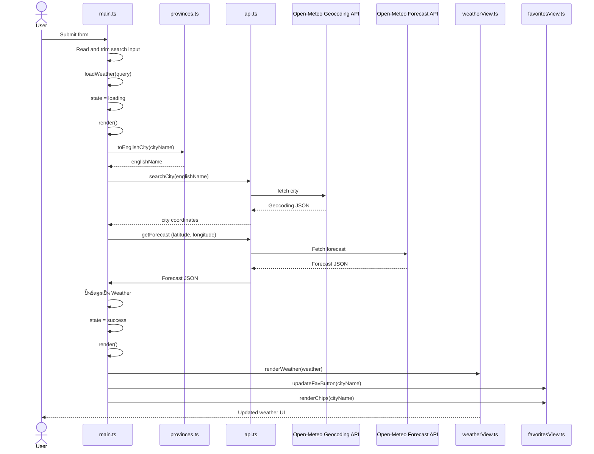

# Architecture Overview

เอกสารนี้อธิบายหน้าที่ของแต่ละไฟล์ ความสัมพันธ์ระหว่างโมดูล และการไหลของข้อมูลในโปรเจกต์ Weather Explorer

## 1. ไฟล์อิสระที่ไม่ import โมดูลอื่น

### `src/provinces.ts`

- **Responsibility:** แปลงชื่อจังหวัด/ชื่อเมืองภาษาไทยหรือคำย่อ ให้เป็นชื่อภาษาอังกฤษสากล
- **Input:** `input: string` — ชื่อเมืองที่ส่งมาจาก `main.ts`
- **Output:** `string` — ชื่อเมืองภาษาอังกฤษ
- **Dependencies:** ไม่มี (ไม่พึ่งพาโมดูลอื่น)
- **State / Side effects:** ไม่มี — เป็น Pure Function / Stateless

### `src/types.ts`

- **Responsibility:** กำหนดโครงสร้างข้อมูลเข้าและออกของระบบ
- **Input:** ไม่มี
- **Output:** `export type` ส่งไปให้ไฟล์ต่าง ๆ ที่ต้องการใช้
- **Dependencies:** ไม่มี
- **State / Side effects:** ไม่มี

### `src/storage.ts`

- **Responsibility:** เก็บข้อมูลเมืองโปรดไว้ใน LocalStorage โดยเรียกใช้เป็นข้อมูลตั้งต้นตอนเปิดหน้าเว็บ เพิ่ม หรือลบข้อมูลได้
- **Input:**
  - `getFavorites()`: ไม่มี input
  - `saveFavorite(cityName: string)`: รับชื่อเมืองเพื่อเพิ่มหรือลบ
- **Output:**
  - `getFavorites(): string[]` — คืนอาเรย์รายชื่อเมือง
  - `saveFavorite(): void` — บันทึกข้อมูลลง LocalStorage โดยไม่คืนค่า
- **Dependencies:** Browser APIs: `localStorage`, `alert`, `console`
- **State / Side effects:** อ่าน/เขียนข้อมูลลง Browser LocalStorage และแจ้งเตือนกรณีผู้ใช้บันทึกชื่อเมืองเกิน 4 เมือง

## 2. ไฟล์ logic และดึงข้อมูลจากภายนอก

### `src/api.ts`

- **Responsibility:** นำชื่อเมือง `cityName` ไปขอข้อมูล latitude/longitude เพื่อนำไปขอข้อมูลสภาพอากาศ JSON ต่อ
- **Input:**
  - `searchCity(cityName: string)`: รับชื่อเมืองภาษาอังกฤษ
  - `getForecast(latitude: number, longitude: number)`: รับค่าพิกัดละติจูดและลองจิจูด
- **Output:**
  - `searchCity()`: ข้อมูล `{ name, latitude, longitude }`
  - `getForecast()`: ข้อมูล forecast JSON ดิบจาก API ซึ่ง `main.ts` นำไปใช้เป็น `ForecastResponse`
- **Dependencies:** `types.ts` สำหรับ `GeocodingResponse` และ Browser `fetch`
- **State / Side effects:** `searchCity` และ `getForecast` มีการยิง request ไปยัง network

### `src/utils.ts`

- **Responsibility:** รวม pure logic หลาย ๆ ตัว
  1. `getWeatherInfo` นำ code ที่ได้จาก JSON มาแปลงเป็นคำบรรยายสภาพอากาศและไอคอน FontAwesome สำหรับแสดงบน UI
  2. `calculateWeeklyStats` หาค่าสูงสุด ต่ำสุด และค่าเฉลี่ยจาก temp ที่ได้จาก JSON โดยใช้ `reduce`
  3. `formatDayName` แปลงวันที่ที่ได้จาก JSON มาเป็นวัน
  4. `getHumidityDesc` แปลงความชื้นที่ได้จาก JSON มาเป็นสถานะ
  5. `getWindDesc` แปลงแรงลมที่ได้จาก JSON มาเป็นสถานะ
  6. `getFeelsLikeDesc` แปลงความรู้สึกจากสภาพอากาศที่ได้จาก JSON มาเป็นสถานะ
  7. `getUvDesc` แปลง UV ที่ได้จาก JSON มาเป็นสถานะ
- **Input:** ข้อมูลสภาพอากาศจาก `main.ts` เป็นส่วนใหญ่
  1. code สภาพอากาศ และ `is_day`
  2. `maxTemps: number[]`, `minTemps: number[]`
  3. `dateStr: string`, `index: number`
  4. `humidity: number`
  5. `speed: number`
  6. `temp: number`
  7. `uv: number`
- **Output:** ข้อมูลที่ผ่านการแปลงจาก JSON ไปเป็นข้อความสถานะ หรือข้อมูลเพื่อนำไปวาดจอ
  1. ข้อมูลสภาพอากาศ type `WeatherInfo` — คำบรรยายและไอคอน
  2. ข้อมูลอุณหภูมิ type `WeeklyStats`
  3. ข้อความวันที่
  4. ข้อความสถานะความชื้น
  5. ข้อความสถานะแรงลม
  6. ข้อความสถานะความรู้สึกได้
  7. ข้อความสถานะ UV
- **Dependencies:** `types.ts` สำหรับกำหนดโครงสร้างข้อมูลบางอย่าง
- **State / Side effects:** ไม่มี — เป็น Pure Functions (โดย `formatDayName` อาศัย timezone ของ browser เพื่อแปลงวันที่)

## 3. ไฟล์วาดหน้าจอ

### `src/weatherView.ts`

- **Responsibility:** นำข้อมูลมาวาดหน้าจอในส่วน Hero, Weekly Stats และ Forecast Grid การ์ด 7 ใบ
- **Input:** รับข้อมูลจาก `main.ts` เป็น `data: Weather` ที่ปั้นเสร็จแล้วพร้อมหยอดลงช่องในหน้าจอ
- **Output:** คืนค่า `void` และทำ side effect โดยวาดข้อมูลลง DOM
  1. **Hero**
     - `cityNameEl.textContent` วาดชื่อเมือง
     - `currTempEl.textContent` วาดอุณหภูมิ
     - `weatherDesEl.textContent` วาดคำอธิบายสถานะสภาพอากาศ
     - `dateEl.textContent` วาดวันปัจจุบันที่ user เปิดดู
     - `heroIconEl.className` วาดไอคอนใหญ่ FontAwesome ที่ `main.ts` คำนวณไว้แล้วใน `data.icon`
     - `humidityEl.textContent` วาดเลขสถานะความชื้น
     - `humidityDescEl.textContent` วาดสถานะบรรยายความชื้นจาก `getHumidityDesc`
     - `windEl.textContent` วาดเลขสถานะแรงลม
     - `windDescEl.textContent` วาดสถานะบรรยายแรงลมจาก `getWindDesc`
     - `feelsEl.textContent` วาดเลขสถานะความรู้สึกจากสภาพอากาศ
     - `feelsLikeDescEl.textContent` วาดสถานะบรรยายความรู้สึกจาก `getFeelsLikeDesc`
     - `uvEl.textContent` วาดเลขสถานะ UV
     - `uvDescEl.textContent` วาดสถานะบรรยาย UV จาก `getUvDesc`
  2. **Weekly Stats**
     - `#weekly-max` วาดอุณหภูมิสูงสุดใน 7 วัน (`temps.max`)
     - `#weekly-min` วาดอุณหภูมิต่ำสุดใน 7 วัน (`temps.min`)
     - `#weekly-avg` วาดอุณหภูมิเฉลี่ยทั้งสัปดาห์ (`temps.avg`)
  3. **Forecast Grid (การ์ดพยากรณ์ 7 วัน)**
     - ใช้ `.map()` วนลูปสร้างการ์ด 7 ใบ ดึง icon ประจำวันจาก `getWeatherInfo` และแปะคลาส `active` สำหรับรายการแรก
- **Dependencies:**
  - `types.ts` — ใช้ type `Weather`
  - `utils.ts` — ใช้ `calculateWeeklyStats`, `getWeatherInfo` และฟังก์ชันตัดเกรด 4 สถานะ
- **State / Side effects:** ไม่มี state ภายใน แต่เป็น Impure Function เพราะดึงและแก้ไข DOM

### `src/favoritesView.ts`

- **Responsibility:** ดูแลการแสดงผลหน้าตา UI ของปุ่มเมืองโปรดทั้งหมด: วาดแถบชิปรายการโปรด และสลับสถานะปุ่มกดบันทึกใต้ชื่อเมือง โดยไม่มีการจัดการข้อมูลเอง
- **Input:**
  1. `renderChips(activeCity?: string)`: รับชื่อเมืองปัจจุบัน (optional) จาก `main.ts` เพื่อนำไปไฮไลต์สีฟ้า
  2. `upadateFavButton(cityName: string)`: รับชื่อเมืองปัจจุบันจาก `main.ts` เพื่อเช็คสถานะการบันทึก
- **Output:**
  1. `renderChips(activeCity?: string)`: คืนค่า `void` และนำรายชื่อเมืองจาก storage มาวนลูปสร้างแท็ก `<button class="chip">` หยอดลงใน `#favorite-chips`
  2. `upadateFavButton(cityName: string)`: คืนค่า `void` และสลับคลาส `.active` พร้อมข้อความ/ไอคอนของ `#fav-toggle-btn` ระหว่าง “บันทึกแล้ว” กับ “เพิ่มในรายการโปรด”
- **Dependencies:** `src/storage.ts` — เรียกใช้ `getFavorites` เพื่ออ่านข้อมูลเมือง
- **State / Side effects:** ไม่มี state ภายใน เป็น Impure Functions เพราะอ่าน LocalStorage ภายนอกและแก้ไข HTML DOM

## 4. ไฟล์ใหญ่ตัวคุมหลัก

### `src/main.ts`

- **Responsibility:** เป็นจุดเริ่มของเว็บ รอฟังค่าจาก user เรียกใช้ฟังก์ชันอื่น ๆ เพื่อหาข้อมูล และสั่งวาดจอตามสถานะ `state`
- **Input:**
  1. **User events:** พิมพ์ชื่อเมือง, คลิกปุ่มเมืองโปรด, บันทึก, ลบ หรือกดดูเมือง
  2. **External data:** ข้อมูลสภาพอากาศ JSON จาก API และข้อมูลเมืองโปรดที่อ่านผ่าน `storage.ts`
- **Output:**
  1. `render(): void` เปลี่ยนหน้าตาของเว็บระหว่าง `idle`, `loading`, `error` หรือ `success`
  2. สั่ง `storage.ts` บันทึกเมืองโปรด และสั่ง View อัปเดต DOM
- **Core Engine:**
  1. `render(): void` ดูตัวแปร `state` ว่าตอนนี้เป็นอะไร แล้วสั่งเปิด/ปิด/วาดหน้าจอ
  2. `loadWeather(cityName): Promise<void>` สับ state เป็น loading → แปลงชื่อไทยเป็นอังกฤษ → ยิงขอพิกัด → ยิงขอสภาพอากาศ → ปั้นก้อนข้อมูล `Weather` → สับ state เป็น success → สั่ง `render()`
- **Dependencies:**
  - `searchCity`, `getForecast` จาก `api.ts`
  - `formatDayName`, `getWeatherInfo` จาก `utils.ts`
  - `saveFavorite` จาก `storage.ts`
  - `Weather`, `AsyncState`, `ForecastResponse` จาก `types.ts`
  - `renderWeather` จาก `weatherView.ts`
  - `renderChips`, `upadateFavButton` จาก `favoritesView.ts`
  - `toEnglishCity` จาก `provinces.ts`
- **State / Side effects:** `state: AsyncState<Weather>` เป็นแหล่งข้อมูลกลางของสถานะการโหลดและข้อมูลอากาศที่กำลังแสดง ส่วนรายการเมืองโปรดเก็บใน LocalStorage; module นี้ประสาน side effects เช่น network, DOM และ LocalStorage ผ่านโมดูลต่าง ๆ

## 5. Sequence Diagrams
### 5.1 Search and render weather

### 5.2 Favorite Toggle Flow
- ค่อยแวะมาฝึกแกะอีก