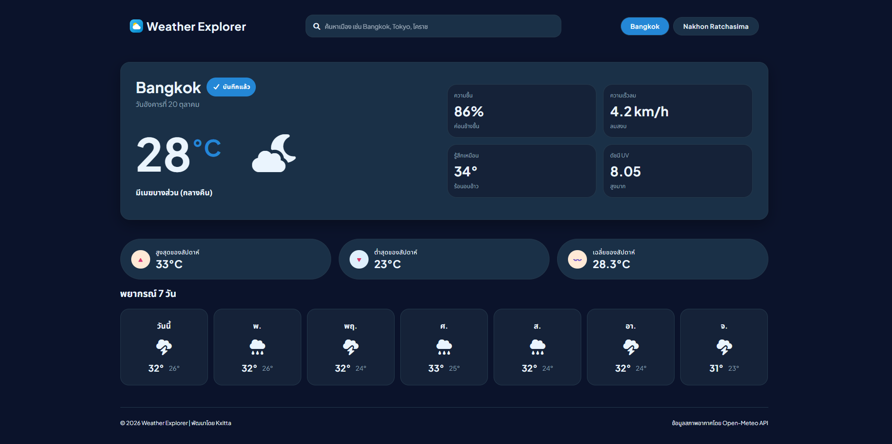
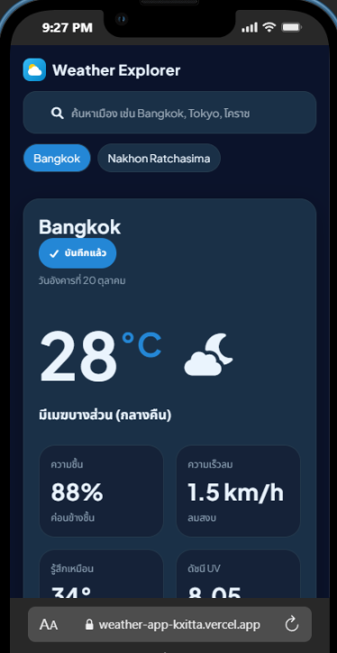

# Weather Explorer

เว็บแอปสำหรับพยากรณ์อากาศและแดชบอร์ดสภาพอากาศล่วงหน้า 7 วัน พัฒนาด้วย **Vanilla TypeScript**, **HTML5/CSS3** และดึงข้อมูลสดจาก **Open-Meteo API**

[DEMO](https://weather-app-kxitta.vercel.app) | [ARCHITECTURE.md](ARCHITECTURE.md)

---
## Screenshots

| Desktop View | Mobile View |
| :---: | :---: |
|  |  |
---
## Features
- ค้นหาชื่อเมืองภาษาไทย/อังกฤษ
- แสดงสภาพอากาศปัจจุบันและพยากรณ์ 7 วัน
- สถานะ Loading และ Error
- บันทึกเมืองโปรดผ่าน LocalStorage
- รองรับหน้าจอขนาดต่าง ๆ
---

## Tech Stack

- **Frontend:** HTML5, CSS3, TypeScript
- **Build Tool:** Vite
- **Package Manager & Runtime:** Bun
- **Deployment:** Vercel
- **Weather API:** [Open-Meteo](https://open-meteo.com/) — ใช้ Geocoding API สำหรับค้นหาพิกัดเมือง และ Forecast API สำหรับดึงข้อมูลสภาพอากาศ
- **Development Tools:** VS Code, Git
- **AI Assistance:** Gemini Flash 3.8, Codex — ใช้ช่วยทบทวนแนวคิด ตรวจสอบ code smells และอธิบาย mental models

---
## วิธีการรันโปรเจกต์ในเครื่อง (Getting Started)

```bash
# 1. โคลนโปรเจกต์ลงเครื่อง
git clone https://github.com/kxitta/weather-explorer.git
cd weather-explorer

# 2. ติดตั้งแพ็กเกจ
bun install

# 3. รันเซิร์ฟเวอร์สำหรับเขียนโค้ด
bun run dev

# 4. เช็คความถูกต้องของ TypeScript
bun x tsc --noEmit
```


---
## โครงสร้างโปรเจกต์ (Project Structure)

```text
weather-explorer/
├── src/
│   ├── api.ts            # เชื่อมต่อ Open-Meteo Geocoding & Forecast APIs
│   ├── provinces.ts      # ตารางเทียบชื่อ 77 จังหวัดภาษาไทยเป็นสากลสำหรับค้นหา
│   ├── utils.ts          # Pure Functions แปลงรหัส WMO, จัดการไอคอน และคำนวณสถิติ
│   ├── storage.ts        # จัดการบันทึกเมืองโปรดลง Browser LocalStorage อย่างปลอดภัย
│   ├── types.ts          # Strict Types และ Interface ทั้งหมดในระบบ
│   ├── weatherView.ts    # [View] วาด Hero Card, แถบสถิติ และการ์ดพยากรณ์ 7 วัน
│   ├── favoritesView.ts  # [View] วาดปุ่มชิปเมืองโปรดและปุ่มบันทึกบน Hero Card
│   ├── main.ts           # [Orchestrator] คุม State, ดัก Event Listeners และสั่ง View
│   └── style.css         # Responsive Styling ด้วย Flexbox & CSS Grid
├── index.html            # โครงสร้าง Semantic HTML
├── ARCHITECTURE.md       # สถาปัตยกรรมระบบและวงจรการทำงานโดยละเอียด
└── README.md             # ภาพรวมโปรเจกต์และบันทึกการเรียนรู้
```

## Architecture
อ่านรายละเอียดสถาปัตยกรรมเชิงลึกและลำดับการเดินทางของข้อมูลได้ที่ [ARCHITECTURE.md](ARCHITECTURE.md)

---
## บันทึกความรู้สึกและสิ่งที่ได้เรียนรู้ 

## สิ่งที่ได้เรียนรู้
โปรเจกต์นี้เป็นโปรเจกต์แรกที่ผมได้พัฒนาในสเกลที่ใหญ่ขึ้น ทำให้ได้ฝึกทักษะหลายด้าน ตั้งแต่การแยกไฟล์และจัดโครงสร้างโปรเจกต์ การแกะ layout จาก Mock UI การเขียนเอกสาร Architecture ไปจนถึงการวาด Sequence Diagram ด้วย Mermaid

ช่วงแรกผมเริ่มเขียน logic รวมไว้ใน `main.ts` ทำให้โค้ดเริ่มซับซ้อนและไล่ flow การทำงานได้ยาก จึงได้กลับมานั่ง refactor และแยกความรับผิดชอบของแต่ละส่วนออกเป็นโมดูล เช่น API, storage, utilities และ views ประสบการณ์นี้ทำให้ผมตกผลึกว่า ก่อนเริ่มเขียนโค้ด ควรวางโครงสร้างข้อมูลและ logic flow คร่าว ๆ ก่อน เพื่อให้มองภาพรวมของระบบได้ชัดเจน และจัดการโค้ดได้ง่ายขึ้นเมื่อโปรเจกต์โตขึ้น

เป้าหมายของโปรเจกต์นี้คือการฝึกพัฒนาเว็บแอปที่มีความซับซ้อนมากขึ้น โดยได้ฝึกเรียกใช้ API รับและจัดการข้อมูล JSON แปลงข้อมูลให้อยู่ในรูปแบบที่เหมาะกับหน้าเว็บ จัดการ state และนำข้อมูลไปแสดงผลบน DOM เพื่อให้ผู้ใช้ใช้งานได้จริง

## สิ่งที่ได้เรียนรู้และฝึกทำจริง

โปรเจกต์นี้เป็นโปรเจกต์แรกที่ผมได้ลองทำเว็บในสเกลที่ใหญ่ขึ้น ทำให้ได้เจอปัญหาจริงมากกว่าการทำแบบฝึกหัดสั้น ๆ และได้ฝึกแก้ปัญหาทีละส่วน

1. **ฝึกแกะหน้าตาเว็บจากภาพตัวอย่าง (Mock UI)**

   - ได้ฝึกมองภาพหน้าจอให้ออกเป็นกล่องย่อย ๆ และคิดว่าแต่ละส่วนควรใช้ HTML element อะไร
   - ได้ฝึกจัด layout ด้วย CSS Flexbox และ Grid รวมถึงการแยกส่วน Hero, สถิติรายสัปดาห์ และการ์ดพยากรณ์อากาศ

2. **ฝึกจัดโครงสร้างโปรเจกต์และแยกไฟล์**

   - ช่วงแรกผมเขียน logic หลายอย่างรวมไว้ใน `main.ts` ทำให้โค้ดเริ่มตีกันและไล่ flow การทำงานได้ยาก
   - หลังจากนั้นจึงได้ refactor โดยแยกหน้าที่ของแต่ละไฟล์ เช่น `api.ts` สำหรับเรียก API, `storage.ts` สำหรับ LocalStorage, `utils.ts` สำหรับ logic ที่ใช้ซ้ำ และแยก View สำหรับวาดหน้าจอ
   - ทำให้เข้าใจมากขึ้นว่าการแยกไฟล์ไม่ได้ทำเพื่อให้โค้ดดูสวยอย่างเดียว แต่ช่วยให้แก้บั๊กและอ่านโค้ดในอนาคตง่ายขึ้น

3. **ฝึกควบคุม DOM และเข้าใจการทำงานแบบ Event-Driven**

   - ได้ทำหน้าจอหลายสถานะ เช่น Loading, Error และ Success
   - ได้เข้าใจว่าเว็บไม่ได้ทำงานจากบนลงล่างตลอดเวลา แต่จะรอ Event เช่น ผู้ใช้ submit ฟอร์ม กดปุ่มเมืองโปรด หรือคลิก chip เมือง
   - ได้ฝึกใช้ `addEventListener()` และให้ `main.ts` เป็นตัวรับ event แล้วสั่งส่วนอื่นทำงานต่อ

4. **ฝึกเรียก API และจัดการข้อมูล JSON**

   - ได้ฝึกส่งชื่อเมืองไปหา latitude/longitude ก่อน แล้วจึงนำพิกัดไปขอข้อมูลพยากรณ์อากาศจาก Open-Meteo API
   - ได้ฝึกใช้ `async/await`, `fetch` และ `try...catch` เพื่อรองรับกรณีหาเมืองไม่เจอหรือเกิดปัญหาจาก network
   - ได้ฝึกนำ JSON ดิบจาก API มาแปลงเป็นข้อมูล `Weather` ที่หน้าเว็บนำไปแสดงได้ง่ายขึ้น

5. **ฝึกจัดการ State และข้อมูลเมืองโปรด**

   - ได้ใช้ `AsyncState` เพื่อจัดการสถานะ `loading`, `success` และ `error`
   - ได้ฝึกใช้ LocalStorage เพื่อบันทึกเมืองโปรด เพิ่ม/ลบเมือง และนำข้อมูลเดิมกลับมาใช้เมื่อเปิดเว็บ
   - ได้เรียนรู้เรื่อง Guard Clause และการเปรียบเทียบชื่อเมืองแบบไม่สนตัวพิมพ์เล็ก-ใหญ่ เพื่อช่วยลดโอกาสเกิดบั๊ก

6. **ฝึกเขียน Architecture และวาด Sequence Diagram**

   - หลังจากเริ่มสับสนกับ flow ของโค้ด ผมได้ลองเขียน `ARCHITECTURE.md` เพื่อสรุปว่าทุกไฟล์มีหน้าที่อะไร รับข้อมูลจากไหน และส่งข้อมูลต่อไปที่ไหน
   - ได้ฝึกไล่ flow จาก event ใน `main.ts` ไปยัง `api.ts`, Open-Meteo API และ View
   - ได้วาด Sequence Diagram ด้วย Mermaid เพื่อเห็นลำดับการทำงานจริง ตั้งแต่ผู้ใช้ค้นหาเมืองจนเว็บแสดงข้อมูลอากาศ

7. **สิ่งที่ตกผลึกจากโปรเจกต์นี้**

   - ก่อนเริ่มเขียนโค้ด ควรร่าง data flow และ logic คร่าว ๆ ก่อน
   - ไม่จำเป็นต้องเข้าใจทุกอย่างตั้งแต่แรก แต่ควรแยกปัญหาให้เล็กลง แล้วไล่ตาม flow ทีละขั้น
   - การ refactor ไม่ได้แปลว่าเขียนโค้ดรอบแรกผิดเสมอไป แต่เป็นส่วนหนึ่งของการพัฒนาเมื่อเราเริ่มเข้าใจปัญหาและโครงสร้างของโปรเจกต์มากขึ้น
---

